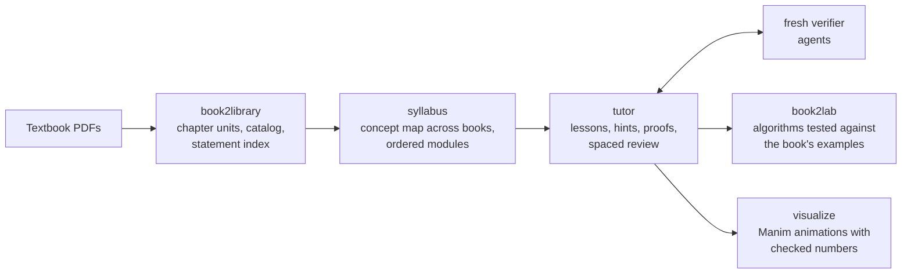

# Textbook2Agent

[](https://github.com/vohuynhquangnguyen/textbook2agent/actions/workflows/ci.yml)
[](LICENSE)

Textbook2Agent is an agent skill for self-studying a topic from a list of textbooks. It turns your PDFs into one
searchable library with printed-page citations, plans a route through the books, tutors you along it, and can
animate a concept with [Manim](https://www.manim.community/). Every proof, solution and quoted definition the agent
writes goes to a fresh verifier agent before you see it as correct.

It adapts [Paper2Agent](https://github.com/jmiao24/Paper2Agent), which turns a research paper into a reading skill
and its code into tested tools, from one paper to several textbooks.



| Component | What it does | Adapted from |
| --- | --- | --- |
| **book2library** | Splits each book into chapters and extracts them into searchable text. Indexes numbered Definitions, Theorems, Examples and Exercises across all books with printed page numbers, and lists numbers it may have missed. Chapters you are studying get a page-by-page review with formulas in LaTeX. | paper2skill (engine included unchanged) |
| **syllabus** | Maps where each concept is defined in each book, flags books that define the same word differently, and orders the material into modules, each with readings, exercises, a checkpoint and the results you may cite. | — |
| **tutor** | Lessons built up from foundations with numerical worked examples; exercises as staged hints, your attempt, then a full proof (optionally listing every definition used); review of your own proofs; progress tracking with spaced review. | — |
| **book2lab** | Implements algorithms from the books and tests them against the numbers the books print, then runs experiments that check the theory (convergence, error bounds, sensitivity). | paper2mcp |
| **visualize** | Turns a concept, proof idea or algorithm into a short Manim animation: a storyboard tied to the proof steps, every number computed and checked in code, frames reviewed, and every on-screen claim verified. Videos split into beats, so an exercise hint can be released one beat at a time. Two worked examples are included (below). | — |

## Install

The simplest way is to ask your coding agent (Claude Code, Codex, …):

```text
Read https://github.com/vohuynhquangnguyen/textbook2agent and install the textbook2agent skill
from skills/textbook2agent for this coding agent.
```

Restart the agent if the skill does not appear. To install by hand, copy the whole `skills/textbook2agent` folder,
including its subfolders (to upgrade, delete the installed folder first so removed files do not linger):

**Claude Code on macOS or Linux**

```bash
git clone https://github.com/vohuynhquangnguyen/textbook2agent.git
mkdir -p ~/.claude/skills/textbook2agent
cp -R textbook2agent/skills/textbook2agent/. ~/.claude/skills/textbook2agent/
```

**Claude Code on Windows (PowerShell)**

```powershell
git clone https://github.com/vohuynhquangnguyen/textbook2agent.git
New-Item -ItemType Directory -Force "$env:USERPROFILE\.claude\skills\textbook2agent" | Out-Null
Copy-Item -Recurse -Force textbook2agent\skills\textbook2agent\* "$env:USERPROFILE\.claude\skills\textbook2agent\"
```

**Codex**: copy the same folder to `~/.agents/skills/textbook2agent`.

**Claude apps**: download `textbook2agent-<version>.zip` from the
[latest release](https://github.com/vohuynhquangnguyen/textbook2agent/releases/latest) and upload it as a skill,
where your plan supports custom skills.

### Requirements

- Python 3.11 or newer and [uv](https://docs.astral.sh/uv/). The scripts declare their pinned dependencies, and
  `uv run` installs them on first use.
- [Tesseract](https://github.com/tesseract-ocr/tesseract), only for scanned books.
- For animations only: a LaTeX distribution with `dvisvgm` (MiKTeX or TeX Live), and on macOS and Linux the Cairo
  (and on Linux also Pango) development libraries. See the
  [Manim guide](skills/textbook2agent/visualize/references/manim-guide.md) for per-platform steps.
- About 0.7 MB of disk per book page for the working files. A 400-page book drafts in about four minutes.
- On Windows, keep the study folder path short (for example `C:\study\analysis`).

## Use

Start a study project:

```text
Use the textbook2agent skill to help me self-study <topic>.
Books: <paths to the PDFs>
Goal: <what you want to be able to do, and by when>
Study workspace: <a folder for the library, plan and progress>
```

Later sessions:

```text
Continue my <topic> study in <workspace>.
Give me hints for <book> exercise 2A.4. I'll attempt it first.
Review my proof in <file> using only <book> up to §2C.
Implement <book> Algorithm 2.3 and check its convergence rate.
Animate why sin(x)/x is not in L^1 but its improper integral converges.
```

### Example animations

Both examples ship with their storyboard, the code that computes and checks every number on screen, and the scene:

- [sin(x)/x is not in L¹(ℝ), yet its improper integral converges](skills/textbook2agent/visualize/examples/sinc-improper-integral/):
  humps, the harmonic lower bound, divergence on a log scale, the alternating series, and the limit through all
  real T.
- [Gauss–Newton for linear regression](skills/textbook2agent/visualize/examples/gauss-newton-linear-regression/):
  linearize, solve, update; one step to the least-squares fit in parameter space; why (the model is exact);
  gradient descent crawling along a badly conditioned valley; and a nonlinear model that needs several steps.

Render one yourself:

```bash
uv run skills/textbook2agent/visualize/scripts/render_scene.py \
  skills/textbook2agent/visualize/examples/gauss-newton-linear-regression/scene.py GaussNewtonLinearRegression \
  --quality preview
```

The skill keeps everything in the study workspace, so the next session continues where the last one stopped:

```text
<study-root>/
├── profile.md          your background, goal and preferences (explanation style, proof format, ...)
├── library-plan.json   the books and how each splits into chapters (editable)
├── library/            the generated library: catalog, statement index, chapter texts
├── plan/               concept map and syllabus
├── bank/               definitions and theorems copied from page images and verified
├── lessons/ sessions/ exercises/ lab/ visuals/
├── progress.md         modules, confidence per concept, review dates, misconceptions
└── .tutor/ .work/      prepared answers kept out of sight, and extraction evidence
```

## How it keeps the mathematics right

- **The books are the authority.** Definitions and theorems are quoted verbatim with citations such as
  `[book-id] Definition 2.7, p. <printed page> (PDF <page>)`, never paraphrased.
- **Draft text is a locator, not a source.** Automatic extraction garbles inline mathematics and turns displayed
  formulas into images, so anything quoted from a draft chapter is first copied from the rendered page image.
- **Fresh verifiers.** Each agent-written proof, solution, counterexample or transcription goes to a new agent
  that did not write it, with only the problem, the allowed results and the argument. It tries to break the
  argument and tests numerical claims with code.
- **Citation scope.** Each module states which results may be cited (for example "only up to §2C") and what
  background is allowed; verifiers reject anything outside it.
- **Strict checks for reviewed chapters.** Reviewed chapters pass paper2skill's text, number and image
  verification. A warning is cleared automatically only when it comes from transcribing a displayed formula to
  LaTeX: the line must sit in a detected formula region with its letters, digits and comparison or operator
  symbols unchanged and in order. Changed wording is never cleared. Subscript placement and other symbols are
  invisible to that check and rely on the symbol-by-symbol review against the page image.

## Limitations

- Draft extraction is only as good as the PDF: inline symbols are often garbled, and exercises printed as bare
  numbers can be missed. The catalog lists likely gaps, and the tutor reads statements from page images.
- A full page-by-page review takes real agent time; it is meant for the chapters you are studying, not whole books.
- Books without a PDF outline must be split into chapters by hand.
- Verification by a second agent reduces errors but does not guarantee correctness. When the host cannot start
  another agent, the skill does a separate checking pass and tells you; after three failed rounds it shows the
  best version with the unresolved issue stated. Check important results yourself.

## Copyright and privacy

Textbook2Agent never ships book content. Your PDFs, extracted text and page images stay in your study workspace
on your machine. Keep that workspace outside any clone of this repository and out of public repositories, and do
not paste book text into issues. As a safety net, this repository's `.gitignore` excludes PDFs, `library/`,
`bank/`, `.work/` and `.tutor/`, but not your other study files.

## Development

```text
skills/textbook2agent/            the skill (this folder is what gets installed)
├── SKILL.md                      router: which component handles a request
├── book2library/                 library builder (scripts/, templates/, references/)
│   └── scripts/paper2skill/      Paper2Agent's extraction engine, unchanged
├── visualize/                    Manim scene kit, render script, guide and two worked examples
└── syllabus/  tutor/  book2lab/
tests/test_skill_package.py       skill metadata and link checks
.github/                          CI, release workflow and the packaging script
```

Run the checks (the same ones CI runs):

```bash
uv run tests/test_skill_package.py
uv run skills/textbook2agent/book2library/scripts/test_textbook_library.py
uv run skills/textbook2agent/book2library/scripts/paper2skill/test_paper_bundle.py
uv run skills/textbook2agent/visualize/scripts/test_visualize.py
uvx ruff@0.16.10 check
```

`test_visualize.py` also renders a tiny scene end to end when `TEXTBOOK2AGENT_RENDER_TESTS=1` is set and LaTeX is
installed; CI runs it without that variable.

See [CONTRIBUTING.md](CONTRIBUTING.md) for conventions. To publish a release, push a tag such as `v0.1.0`; the
release workflow attaches `textbook2agent-v0.1.0.zip`, ready for upload as a skill.

## Citation

If Textbook2Agent helps your work, please cite it (see [CITATION.cff](CITATION.cff)) and Paper2Agent:

```bibtex
@article{miao2026paper2agent,
  title={Reimagining research papers as interactive and reliable {AI} agents},
  author={Miao, Jiacheng and Davis, Joe R. and Zhang, Yaohui and Pritchard, Jonathan K. and Zou, James},
  journal={Nature},
  year={2026},
  doi={10.1038/s41586-026-11044-y}
}
```

## License

[MIT](LICENSE). The included Paper2Agent files are MIT-licensed by Jiacheng Miao; see
[THIRD_PARTY_NOTICES.md](THIRD_PARTY_NOTICES.md). The scripts download PyMuPDF at run time, which is licensed under
AGPL-3.0 or a commercial license from Artifex.
